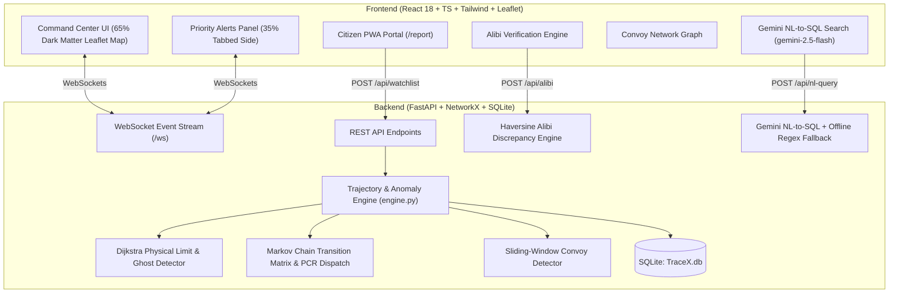

# TraceX — City-Wide ANPR Trajectory Intelligence

**TraceX** is a full-stack municipal intelligence and trajectory anomaly detection platform monitoring real-time Automatic Number Plate Recognition (ANPR) feeds across **12 strategic Delhi arterial corridors** (CAM_01 to CAM_12).

---

## 🏛️ System Architecture



---

## 📍 12 Real Delhi Traffic Junctions (NetworkX Directed Graph)

| Node ID | Junction Name | Corridor / Landmark | Lat / Lon | Speed Limit |
|---|---|---|---|---|
| **CAM_01** | Connaught Place | Outer Circle / Barakhamba Rd Entry | `28.6328, 77.2197` | 50 km/h |
| **CAM_02** | India Gate C-Hexagon | Kartavya Path / Rajpath Crossing | `28.6129, 77.2295` | 60 km/h |
| **CAM_03** | ITO Junction | Vikas Marg & BSZ Marg | `28.6289, 77.2410` | 50 km/h |
| **CAM_04** | Kashmere Gate ISBT | Ring Road / Old Delhi Gate | `28.6665, 77.2332` | 60 km/h |
| **CAM_05** | AIIMS Flyover | Ring Road & Sri Aurobindo Marg | `28.5672, 77.2100` | 60 km/h |
| **CAM_06** | Dhaula Kuan Interchange | NH-48 & Ring Road Flyover | `28.5921, 77.1616` | 70 km/h |
| **CAM_07** | IGI Airport T3 | Airport Access Expressway | `28.5562, 77.1000` | 70 km/h |
| **CAM_08** | Ashram Chowk | Mathura Road & Ring Road Axis | `28.5707, 77.2588` | 60 km/h |
| **CAM_09** | Moti Bagh Junction | Ring Road & Shanti Path Intersection | `28.5833, 77.1744` | 60 km/h |
| **CAM_10** | Lajpat Nagar Flyover | Ring Road Central Market Axis | `28.5700, 77.2400` | 60 km/h |
| **CAM_11** | Karol Bagh (Pusa Road) | Pusa Road Metro Pillar 110 | `28.6469, 77.1895` | 50 km/h |
| **CAM_12** | Sarai Kale Khan RRTS | Ring Road & Barapullah Elevated | `28.5885, 77.2550` | 70 km/h |

---

## ⚡ Core Algorithmic Engines

### 1. Confidence Filter
ANPR readings with an OCR confidence score **$< 0.75$** are discarded immediately to eliminate phantom camera noise.

### 2. Dijkstra Physical Teleportation & Ghost Plate Detector
- Calculates shortest minimum physical traversal time $t_{\text{min}}$ between camera $u$ and camera $v$ using:
  $$\text{min\_time} = \text{nx.dijkstra\_path\_length}(G, u, v, \text{weight}='min\_time')$$
- If the observed elapsed time $t_{\text{actual}} < 0.65 \times t_{\text{min}}$, the vehicle has moved faster than physical laws permit under clear traffic, flagging a **`GHOST_ALERT`** (evidence of duplicate/cloned registration plates).

### 3. Haversine Velocity & Speed Violations
- Haversine distance is computed between consecutive sightings:
  $$\text{speed\_kmh} = \frac{\text{Haversine\_km}}{\Delta t / 3600}$$
- Flagged as **`SPEED_VIOLATION`** when velocity exceeds **$80\text{ km/h}$**.

### 4. Markov Chain Transition Matrix & PCR Interception
- Directed graph transition matrix models vehicle continuation probabilities from junction $i$ to successor $j$.
- Returns top 2 projected next cameras, traffic-calibrated countdown ETA (seconds), and identifies the nearest simulated **PCR Police Patrol Unit** (`PCR_01` to `PCR_06`) with intercept distance and estimated response time.

### 5. Convoy Formation Detector
- Sliding window scans sightings grouped by junction:
  - Co-occurrence: $|\text{timestamp}_A - \text{timestamp}_B| \le 45\text{ seconds}$.
  - Convoy Alert: Triggered when vehicle pairs co-occur across $\ge 3$ consecutive junctions.

### 6. Alibi Verification Engine (`POST /api/alibi`)
- Cross-examines suspect alibi claims against real surveillance records.
- Computes spatial discrepancy distance ($\text{km}$) via Haversine and compares against required velocity.
- Returns judicial verdict: **`CONFIRMED`** or **`BROKEN`**.

### 7. Gemini NL-to-SQL Search (`POST /api/nl-query`)
- Converts user questions in natural language into strict read-only SQLite `SELECT` queries using `google-genai` (`gemini-2.5-flash`).
- Built-in regex and semantic rule-based offline fallback ensures full functionality even without an external API key.

### 8. Integrated Map API Endpoints
- **`GET /api/map`**: Standalone, interactive dark-mode Leaflet Map view served directly as HTML. Embeddable via `<iframe>` or accessed directly in any browser with real-time WebSocket telemetry.
- **`GET /api/map/state`**: Complete real-time JSON map state containing all 12 camera coordinates, 34 arterial corridor edges, active vehicle trajectories grouped by plate (with color-coding), PCR patrol units, and center configuration.
- **`GET /api/map/geojson`**: Standard RFC 7946 GeoJSON `FeatureCollection` for GIS clients (QGIS, Mapbox, Deck.gl).
- **`GET /api/map/trajectory/{plate}`**: Chronological waypoints, GeoJSON `LineString`, speed segments, and Markov next camera projections for any specific vehicle plate.

---

## 🚀 Setup

### Backend
```bash
# In workspace root
source venv/bin/activate
uvicorn backend.main:app --host 127.0.0.1 --port 8000
```

### Frontend (Development)
```bash
cd frontend
npm install
npm run dev
```

### Unified Production Serving
The built frontend is mounted directly inside the FastAPI app. Visiting `http://127.0.0.1:8000/` serves the full UI and WebSocket telemetry.
